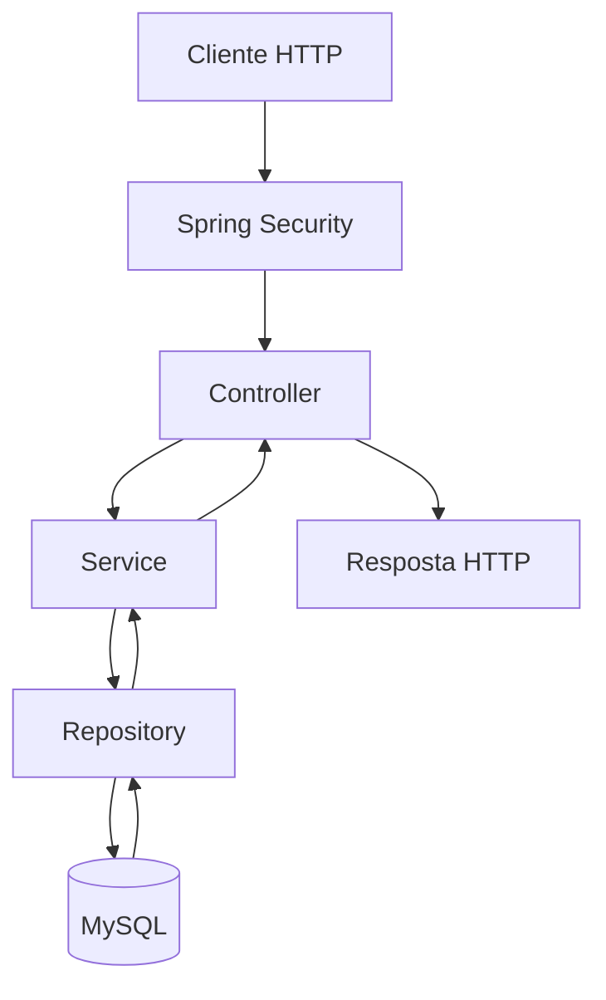
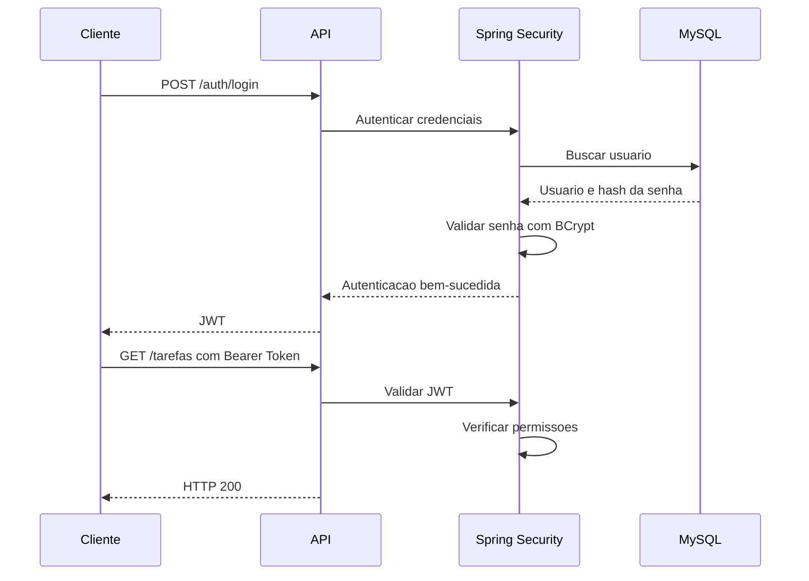
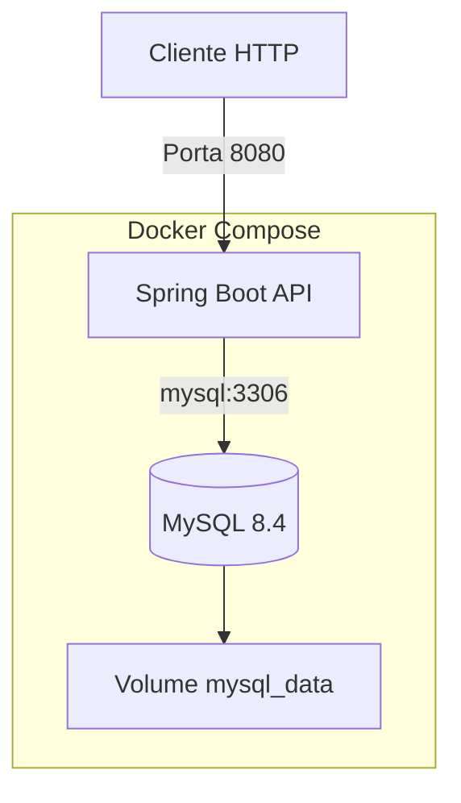
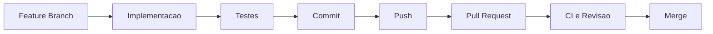

# API de Tarefas — Spring Boot


## Sobre o projeto

API REST desenvolvida em Java com Spring Boot para gerenciamento
de tarefas, autenticação de usuários e controle de acesso baseado
em papéis (RBAC).

O projeto foi desenvolvido com o objetivo de aplicar conceitos
e boas práticas de desenvolvimento Backend, incluindo arquitetura
em camadas, persistência de dados, segurança, testes automatizados,
containerização e versionamento de código.

A aplicação utiliza autenticação Stateless com JWT, armazenamento
seguro de senhas com BCrypt e autorização baseada nas roles
USER e ADMIN.

---

## Tecnologias utilizadas

| Tecnologia | Finalidade |
|---|---|
| Java 25 | Linguagem de programação |
| Spring Boot 4.1.0 | Framework principal |
| Spring Web MVC | Desenvolvimento da API REST |
| Spring Data JPA | Persistência de dados |
| Hibernate | Mapeamento objeto-relacional |
| Spring Security | Autenticação e autorização |
| JWT | Autenticação baseada em tokens |
| BCrypt | Hash de senhas |
| Bean Validation | Validação de dados |
| MySQL 8.4 | Banco de dados de desenvolvimento |
| H2 Database | Banco de dados para testes |
| Maven | Gerenciamento de dependências e build |
| Lombok | Redução de código repetitivo |
| JUnit | Testes automatizados |
| Mockito | Simulação de dependências |
| MockMvc | Testes de endpoints HTTP |
| Docker | Containerização |
| Docker Compose | Orquestração dos containers |
| Git e GitHub | Versionamento de código |
| GitHub Actions | Integração contínua |

---

## Funcionalidades

### Gerenciamento de tarefas

- Cadastrar tarefas.
- Listar tarefas.
- Buscar tarefas por ID.
- Atualizar tarefas.
- Excluir tarefas.
- Buscar tarefas por prioridade.
- Paginação de resultados.
- Validação dos dados de entrada.
- Tratamento centralizado de exceções.
- Respostas HTTP adequadas para cada operação.

### Gerenciamento de usuários

- Cadastro de usuários.
- Validação de nome, e-mail e senha.
- Normalização de endereços de e-mail.
- Prevenção de e-mails duplicados.
- Armazenamento de senhas utilizando BCrypt.
- Autenticação com e-mail e senha.
- Atribuição automática da role USER no cadastro público.

### Segurança

- Autenticação utilizando JWT.
- Assinatura de tokens com HS256.
- Autenticação Stateless.
- Autorização baseada em papéis (RBAC).
- Controle de acesso com roles USER e ADMIN.
- Segurança em nível de método com `@PreAuthorize`.
- Validação de assinatura dos tokens.
- Validação do emissor (issuer).
- Validação da expiração.
- Validação de claims obrigatórias.
- Proteção contra adulteração de tokens.
- Proteção contra elevação de privilégios no cadastro público.
- Gerenciamento de segredos por variáveis de ambiente.

---

## Arquitetura do projeto

O projeto utiliza arquitetura em camadas, separando as
responsabilidades da aplicação para facilitar a manutenção,
a organização e a realização de testes.

| Camada | Responsabilidade |
|---|---|
| Controller | Receber requisições HTTP e retornar respostas |
| Service | Implementar as regras de negócio |
| Repository | Realizar o acesso ao banco de dados |
| Model | Representar as entidades do domínio |
| DTO | Definir os dados de entrada e saída |
| Config | Configurar segurança e componentes da aplicação |
| Exception | Representar exceções personalizadas |
| Handler | Centralizar o tratamento de exceções |
| Response | Padronizar respostas específicas da API |

### Fluxo de uma requisição



### Estrutura de diretórios

```text
src/
├── main/
│   ├── java/
│   │   └── com/vitor/aprendendospring/
│   │       ├── config/
│   │       ├── controller/
│   │       ├── dto/
│   │       ├── exception/
│   │       ├── handler/
│   │       ├── model/
│   │       ├── repository/
│   │       ├── response/
│   │       ├── service/
│   │       └── AprendendospringApplication.java
│   └── resources/
│       ├── application.yaml
│       └── application-dev.yaml
└── test/
    ├── java/
    └── resources/
```

---

## Autenticação e autorização

A aplicação utiliza Spring Security com autenticação baseada
em JSON Web Token (JWT).

Após realizar o login com credenciais válidas, o usuário recebe
um token assinado que deve ser enviado nas próximas requisições
aos endpoints protegidos.

### Fluxo de autenticação



### Características do JWT

- Algoritmo de assinatura: HS256.
- Emissor: `api-tarefas`.
- Tempo de expiração padrão: 3600 segundos (1 hora).
- Chave de assinatura configurada por variável de ambiente.
- Validação de assinatura, expiração e emissor.
- Identificação do usuário através da claim `sub`.
- Autoridades armazenadas na claim `roles`.

A aplicação não utiliza sessões HTTP para manter a
autenticação dos usuários.

---

## Controle de acesso — RBAC

O projeto utiliza Role-Based Access Control (RBAC) para
determinar quais operações cada usuário pode executar.

### USER

Usuário comum da aplicação.

Possui permissão para:

- Cadastrar tarefas.
- Listar tarefas.
- Buscar tarefas.
- Atualizar tarefas.

Não possui permissão para excluir tarefas.

### ADMIN

Administrador da aplicação.

Possui todas as permissões do usuário comum, além da
permissão para excluir tarefas.

O cadastro público sempre atribui a role USER, impedindo
que novos usuários escolham permissões administrativas.

---

## Endpoints da API

### Autenticação

| Método | Endpoint | Descrição | Acesso |
|---|---|---|---|
| POST | `/auth/register` | Cadastrar usuário | Público |
| POST | `/auth/login` | Autenticar e obter JWT | Público |

### Tarefas

| Método | Endpoint | Descrição | USER | ADMIN |
|---|---|---|---|---|
| GET | `/tarefas` | Listar tarefas | Sim | Sim |
| GET | `/tarefas/{id}` | Buscar tarefa por ID | Sim | Sim |
| POST | `/tarefas` | Cadastrar tarefa | Sim | Sim |
| PUT | `/tarefas/{id}` | Atualizar tarefa | Sim | Sim |
| DELETE | `/tarefas/{id}` | Excluir tarefa | Não | Sim |
| GET | `/tarefas/prioridade/{prioridade}` | Buscar por prioridade | Sim | Sim |

### Prioridades disponíveis

- `ALTA`
- `MEDIA`
- `BAIXA`

---

## Status HTTP

A API utiliza códigos de status HTTP para representar
o resultado das operações.

| Status | Significado | Utilização |
|---|---|---|
| 200 | OK | Consulta ou atualização realizada |
| 201 | Created | Recurso cadastrado |
| 204 | No Content | Recurso excluído |
| 400 | Bad Request | Dados inválidos |
| 401 | Unauthorized | Autenticação ausente ou inválida |
| 403 | Forbidden | Permissão insuficiente |
| 404 | Not Found | Recurso não encontrado |
| 409 | Conflict | Conflito de dados ou duplicidade |

---

## Como executar o projeto

### Pré-requisitos

Para executar utilizando Docker:

- Git.
- Docker Desktop ou Docker Engine.
- Docker Compose.

Para desenvolvimento e execução dos testes:

- JDK 25.
- IntelliJ IDEA ou outra IDE Java.
- Maven instalado ou configurado na IDE.

Não é necessário instalar Java, Maven ou MySQL diretamente
no computador para executar a aplicação utilizando Docker.

### 1. Clonar o repositório

```bash
git clone https://github.com/DevVitorhf/api-tarefas-spring-boot.git
```

Acesse o diretório:

```bash
cd api-tarefas-spring-boot
```

### 2. Configurar as variáveis de ambiente

Crie um arquivo `.env` na raiz do projeto utilizando
o arquivo `.env.example` como referência.

No PowerShell:

```powershell
Copy-Item .env.example .env
```

No Linux ou macOS:

```bash
cp .env.example .env
```

Configure as seguintes variáveis:

```dotenv
MYSQL_PASSWORD=
MYSQL_ROOT_PASSWORD=
JWT_SECRET=
```

| Variável | Descrição |
|---|---|
| MYSQL_PASSWORD | Senha do usuário da aplicação no MySQL |
| MYSQL_ROOT_PASSWORD | Senha administrativa do MySQL |
| JWT_SECRET | Chave utilizada para assinar e validar JWTs |

Preencha todas as variáveis antes de iniciar a aplicação.

A chave JWT deve possuir pelo menos 32 bytes aleatórios
antes da codificação em Base64.

### Gerando uma chave JWT no PowerShell

```powershell
$bytes = New-Object byte[] 32
$rng = [System.Security.Cryptography.RandomNumberGenerator]::Create()
$rng.GetBytes($bytes)
[Convert]::ToBase64String($bytes)
$rng.Dispose()
```

### Gerando uma chave JWT no Linux ou macOS

```bash
openssl rand -base64 32
```

Armazene a chave gerada na variável `JWT_SECRET`
do arquivo `.env`.

**Nunca publique o arquivo `.env`, senhas, chaves JWT
ou tokens de autenticação no repositório.**

### 3. Validar o Docker Compose

```bash
docker compose config --quiet
```

### 4. Construir e iniciar os containers

```bash
docker compose up -d --build
```

### 5. Verificar os containers

```bash
docker compose ps
```

A aplicação utiliza dois serviços:

| Serviço | Responsabilidade |
|---|---|
| api | Executar a aplicação Spring Boot |
| mysql | Executar o banco de dados MySQL 8.4 |

### 6. Consultar os logs

```bash
docker compose logs -f api
```

### 7. Acessar a aplicação

A API estará disponível em:

```text
http://127.0.0.1:8080
```

Os endpoints de tarefas exigem autenticação.

### 8. Encerrar a aplicação

```bash
docker compose down
```

Os dados do MySQL serão preservados no volume nomeado.

**Atenção:** o comando `docker compose down -v` remove
os volumes gerenciados pelo Compose e pode apagar
os dados armazenados no banco.

---

## Arquitetura Docker

A aplicação utiliza Docker Compose para gerenciar os
containers da API e do banco de dados.

O Dockerfile utiliza Multi-Stage Build para separar
a etapa de compilação da etapa de execução.



### Características

- Compilação da aplicação utilizando Maven.
- Execução utilizando Java 25 JRE.
- Comunicação entre containers por rede interna.
- MySQL sem exposição direta de portas no host.
- API publicada somente na interface local.
- Healthcheck para verificar a disponibilidade do MySQL.
- Persistência de dados utilizando volume nomeado.
- Configuração por variáveis de ambiente.
- Perfil de desenvolvimento ativo.

---

## Exemplos de requisições

As requisições podem ser realizadas utilizando Postman,
Insomnia, cURL ou PowerShell.

### 1. Cadastrar usuário

**POST** `/auth/register`

```json
{
    "nome": "Usuario Teste",
    "email": "usuario@example.com",
    "senha": "SenhaExemplo123"
}
```

Resposta esperada — HTTP 201:

```json
{
    "id": 1,
    "nome": "Usuario Teste",
    "email": "usuario@example.com",
    "role": "USER"
}
```

A senha e seu hash não são retornados pela API.

### 2. Realizar login

**POST** `/auth/login`

```json
{
    "email": "usuario@example.com",
    "senha": "SenhaExemplo123"
}
```

Resposta esperada — HTTP 200:

```json
{
    "token": "<jwt-gerado-pela-aplicacao>",
    "tipo": "Bearer"
}
```

### 3. Autenticar requisições

Após realizar o login, envie o JWT no cabeçalho
Authorization:

```http
Authorization: Bearer <token>
```

### 4. Cadastrar tarefa

**POST** `/tarefas`

Headers:

```http
Authorization: Bearer <token>
Content-Type: application/json
```

Body:

```json
{
    "titulo": "Estudar Java e Spring Boot",
    "prioridade": "ALTA"
}
```

Resposta esperada — HTTP 201:

```json
{
    "id": 1,
    "titulo": "Estudar Java e Spring Boot",
    "prioridade": "ALTA",
    "concluida": false
}
```

### 5. Listar tarefas

**GET** `/tarefas`

Exemplo com paginação:

```http
GET /tarefas?page=0&size=10
```

### 6. Buscar tarefa por ID

**GET** `/tarefas/1`

Resposta esperada — HTTP 200:

```json
{
    "id": 1,
    "titulo": "Estudar Java e Spring Boot",
    "prioridade": "ALTA",
    "concluida": false
}
```

### 7. Buscar tarefas por prioridade

**GET** `/tarefas/prioridade/ALTA`

### 8. Atualizar tarefa

**PUT** `/tarefas/1`

```json
{
    "titulo": "Estudar Spring Security",
    "prioridade": "MEDIA"
}
```

### 9. Excluir tarefa

**DELETE** `/tarefas/1`

A operação exige um JWT com a role ADMIN.

Resultados possíveis:

- HTTP 204: tarefa excluída com sucesso.
- HTTP 401: autenticação ausente ou inválida.
- HTTP 403: usuário sem permissão.
- HTTP 404: tarefa não encontrada.

---

## Testando a API com PowerShell

Defina a URL base:

```powershell
$baseUrl = "http://127.0.0.1:8080"
```

### Cadastrar usuário

```powershell
$cadastro = @{
    nome = "Usuario Teste"
    email = "usuario@example.com"
    senha = "SenhaExemplo123"
} | ConvertTo-Json

Invoke-RestMethod `
    -Uri "$baseUrl/auth/register" `
    -Method Post `
    -ContentType "application/json" `
    -Body $cadastro
```

### Realizar login

```powershell
$credenciais = @{
    email = "usuario@example.com"
    senha = "SenhaExemplo123"
} | ConvertTo-Json

$login = Invoke-RestMethod `
    -Uri "$baseUrl/auth/login" `
    -Method Post `
    -ContentType "application/json" `
    -Body $credenciais

$token = $login.token

$headers = @{
    Authorization = "Bearer $token"
}
```

### Listar tarefas

```powershell
Invoke-RestMethod `
    -Uri "$baseUrl/tarefas" `
    -Method Get `
    -Headers $headers
```

### Cadastrar tarefa

```powershell
$tarefa = @{
    titulo = "Estudar Spring Boot"
    prioridade = "ALTA"
} | ConvertTo-Json

$tarefaCriada = Invoke-RestMethod `
    -Uri "$baseUrl/tarefas" `
    -Method Post `
    -Headers $headers `
    -ContentType "application/json" `
    -Body $tarefa
```

### Buscar tarefa cadastrada

```powershell
$tarefaId = $tarefaCriada.id

Invoke-RestMethod `
    -Uri "$baseUrl/tarefas/$tarefaId" `
    -Method Get `
    -Headers $headers
```

### Testar autorização do usuário comum

```powershell
curl.exe -i -X DELETE `
    "$baseUrl/tarefas/$tarefaId" `
    -H "Authorization: Bearer $token"
```

Resultado esperado para um usuário com role USER:

```http
HTTP/1.1 403 Forbidden
```

---

## Banco de dados

### MySQL

O ambiente Docker utiliza MySQL 8.4 para armazenar
os dados da aplicação.

Características:

- Persistência de usuários e tarefas.
- Restrição de unicidade para e-mails.
- Armazenamento de senhas com BCrypt.
- Persistência utilizando o volume `mysql_data`.
- Comunicação com a API através da rede interna do Docker.

### H2 Database

O H2 é utilizado no ambiente de testes automatizados.

Por ser um banco de dados em memória, permite realizar
testes rápidos e isolados sem depender de um servidor
MySQL externo.

### Entidades principais

#### Tarefa

| Campo | Tipo |
|---|---|
| id | Long |
| titulo | String |
| prioridade | Enum |
| concluida | boolean |

#### Usuario

| Campo | Tipo |
|---|---|
| id | Long |
| nome | String |
| email | String |
| senha | String — hash BCrypt |
| role | Enum — USER ou ADMIN |

---

## Tratamento de exceções

A aplicação utiliza tratamento centralizado de exceções
para padronizar as respostas de erro.

São tratados cenários como:

- Tarefa não encontrada.
- Tarefa duplicada.
- Usuário duplicado.
- Dados de entrada inválidos.
- Credenciais incorretas.

Exemplo de resposta para uma tarefa não encontrada:

```json
{
    "status": 404,
    "mensagem": "Tarefa não encontrada: 1"
}
```

Erros de autenticação e autorização também são tratados
pela cadeia de segurança do Spring Security.

---

## Testes automatizados

O projeto possui 110 testes automatizados aprovados,
utilizando JUnit, Mockito, MockMvc e Spring Boot Test.

### Categorias de testes

| Categoria | Objetivo |
|---|---|
| Testes unitários | Validar regras de negócio isoladamente |
| Testes de Service | Validar operações e exceções |
| Testes de Controller | Validar endpoints e respostas HTTP |
| Testes de integração | Validar a comunicação entre componentes |
| Testes de autenticação | Validar cadastro, login e credenciais |
| Testes de autorização | Validar permissões USER e ADMIN |
| Testes de JWT | Validar geração e integridade dos tokens |
| Testes de BCrypt | Validar armazenamento e verificação de senhas |

### Cenários de segurança testados

- Acesso sem autenticação.
- Acesso com JWT válido.
- Acesso com JWT inválido.
- Token expirado.
- Token com emissor inválido.
- Token com assinatura inválida.
- Token adulterado.
- Token ainda não válido.
- Token sem expiração.
- Token sem subject.
- Tentativa de elevação de privilégios.
- Cadastro público com tentativa de atribuição de ADMIN.
- Exclusão de tarefa sem permissão.
- Exclusão de tarefa por administrador.
- Segurança em nível de método.
- Autenticação Stateless.
- Credenciais inválidas.

### Executando os testes

Com Maven instalado:

```bash
mvn clean test
```

Também é possível executar os objetivos `clean` e `test`
através do painel Maven do IntelliJ IDEA.

### Último resultado validado

```text
Tests run: 110
Failures: 0
Errors: 0
Skipped: 0

BUILD SUCCESS
```

---

## Validação da integração Docker e MySQL

Além dos testes automatizados, foram realizadas
validações manuais no ambiente Docker.

- [x] Inicialização da API e do MySQL.
- [x] Cadastro de usuários.
- [x] Login com credenciais válidas.
- [x] Geração de tokens JWT.
- [x] Cadastro de tarefas autenticado.
- [x] Consulta de tarefas autenticada.
- [x] Bloqueio de exclusão para USER — HTTP 403.
- [x] Exclusão autorizada para ADMIN — HTTP 204.
- [x] Consulta de tarefa excluída — HTTP 404.
- [x] Persistência de usuários após recriação dos containers.
- [x] Verificação do formato BCrypt no MySQL.

---

## Integração contínua

O projeto utiliza GitHub Actions para automatizar
verificações de integração do código.

O versionamento é organizado utilizando branches
de funcionalidades, commits descritivos e Pull Requests.

### Fluxo de desenvolvimento



### Padrão de commits

O projeto utiliza Conventional Commits para manter
o histórico organizado.

Exemplos:

```text
feat: add new feature
fix: correct application behavior
test: add automated tests
docs: update project documentation
refactor: improve code structure
chore: update project configuration
```

---

## Boas práticas aplicadas

- Arquitetura em camadas.
- Separação de responsabilidades.
- Injeção de dependências por construtor.
- Utilização de DTOs.
- Validação de dados de entrada.
- Tratamento centralizado de exceções.
- Utilização adequada de métodos HTTP.
- Utilização adequada de status HTTP.
- Persistência com Spring Data JPA.
- Armazenamento de senhas com BCrypt.
- Autenticação Stateless.
- Autorização baseada em papéis.
- Segurança em nível de método.
- Proteção de informações sensíveis.
- Testes unitários e de integração.
- Containerização com Docker.
- Multi-Stage Build.
- Versionamento utilizando Git.
- Desenvolvimento utilizando feature branches.
- Revisão de alterações através de Pull Requests.

---

## Limitações e melhorias futuras

Este projeto possui finalidade educacional e de portfólio.

A configuração de segurança HTTP atual está direcionada
ao perfil de desenvolvimento.

As tarefas são compartilhadas entre usuários autorizados,
não existindo ainda controle individual de propriedade.

Entre as melhorias planejadas estão:

- [ ] Documentação da API com Swagger e OpenAPI.
- [ ] Migrações de banco de dados com Flyway.
- [ ] Testes de integração com Testcontainers.
- [ ] Controle de propriedade individual das tarefas.
- [ ] Implementação de refresh tokens.
- [ ] Revogação de tokens.
- [ ] Validação da claim audience.
- [ ] Rotação de chaves JWT.
- [ ] Rate limiting para endpoints de autenticação.
- [ ] Configuração de segurança para todos os ambientes.
- [ ] Gerenciamento administrativo de usuários.
- [ ] HTTPS em ambiente de produção.
- [ ] Monitoramento com Spring Boot Actuator.
- [ ] Logs estruturados e observabilidade.
- [ ] Deploy em ambiente de produção.

---

## Objetivo profissional

Este projeto faz parte de uma jornada de desenvolvimento
de competências para atuação como Desenvolvedor Java Backend.

Seu objetivo é demonstrar conhecimentos práticos em
desenvolvimento de APIs REST, bancos de dados relacionais,
segurança de aplicações, testes automatizados, Docker,
integração contínua e boas práticas de engenharia de software.

O projeto está em evolução contínua, recebendo novas
funcionalidades e melhorias conforme o avanço dos estudos.

---

## Autor

Desenvolvido por **DevVitorhf**.

GitHub: [DevVitorhf](https://github.com/DevVitorhf)